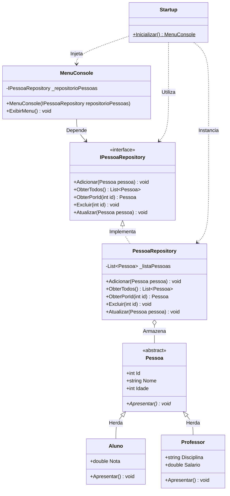

# 🎓 Sistema Escolar CRUD em C# (.NET) 

<p align="left">
  
  
  
  
  
</p>

---

## 📌 Sobre o Projeto & Minha Jornada de Aprendizado

> 👋 Olá! Este é o meu **primeiro projeto desenvolvido em C# e .NET**. 
>
> Estou no processo contínuo de aprofundar meus estudos em **Engenharia de Software**, **Programação Orientada a Objetos (POO)** e **Arquitetura de Sistemas**. Desenvolvi esta aplicação em console para ir muito além de um CRUD básico, aplicando padrões de projeto reais utilizados pelo mercado e entendendo a fundo como os dados navegam entre as camadas e na memória RAM.

---

## 🧠 O Que Aprendi e Apliquei Neste Projeto

Durante a concepção e implementação deste sistema, pude praticar conceitos de nível acadêmico e corporativo:

1. **Programação Orientada a Objetos Avançada (POO):**
   * **Abstração e Herança:** Criação da classe abstrata `Pessoa` servindo de molde base para as entidades derivadas `Aluno` e `Professor`.
   * **Polimorfismo Real:** Sobrescrita do método abstrato `Apresentar()` em cada subclasse, permitindo que cada tipo se apresente com sua formatação exclusiva sem necessidade de condicionais na tela.
   * **Pattern Matching Moderno:** Uso de `if (pessoa is Aluno aluno)` e `else if (pessoa is Professor professor)` para inspeção segura de tipos sem necessidade de coerções (*typecasts*) manuais.

2. **Arquitetura Desacoplada e Princípios SOLID:**
   * **Repository Pattern:** Separação estrita entre o acesso aos dados e a interface visual através da interface `IPessoaRepository`.
   * **S - Princípio da Responsabilidade Única (SRP):** Cada tela do sistema (`CadastrarAlunoScreen`, `ListarPessoasScreen`, etc.) vive em sua própria classe especialista.
   * **D - Princípio da Inversão de Dependência (DIP):** O menu principal recebe a interface `IPessoaRepository` via injeção por construtor, dependendo de abstrações e não de implementações concretas.

3. **Programação Defensiva e Resiliência:**
   * **Zero Exception Crashes:** Uso de `int.TryParse` com parâmetros `out` para garantir validações sem provocar quebras por exceções desnecessárias.
   * **Validação Antecipada (*Fail-Fast*):** Verificação imediata de duplicidade de ID antes de solicitar os demais dados ao usuário.
   * **Localização Cultural Precisa:** Formatação de notas de alunos com ponto (`CultureInfo.InvariantCulture`) e salários com separador de milhar e vírgula (`CultureInfo.GetCultureInfo("pt-BR")`).

---

## 📑 Hub de Documentação Técnica e Diagramas

Este repositório possui uma documentação técnica completa para consulta dos diagramas arquiteturais e fluxos de processos:

| Seção de Documentação | Conteúdo Detalhado | Link de Acesso |
| :--- | :--- | :---: |
| **Central de Documentação** | Visão geral da arquitetura em 3 camadas e decisões de engenharia. | [📂 Acessar Hub Docs](./docs/README.md) |
| **Modelagem UML Completa** | Diagramas de Classes, Casos de Uso e Sequência de Interação. | [📐 Ver Diagramas UML](./docs/uml/README.md) |
| **Fluxos de Dados por Opção** | Mapeamento detalhado de cada uma das 6 opções do console com fluxogramas. | [🔀 Ver Fluxos de Dados](./docs/fluxos/README.md) |

---

## 🏛️ Diagrama Estrutural de Classes (UML)



---

## 📁 Estrutura de Diretórios do Projeto

```text
CRUD/
├── docs/                           # Documentação Técnica e Diagramas
│    ├── README.md                  # Hub Central de Documentação
│    ├── uml/                       # Diagramas UML (Classes, Casos de Uso, Sequência)
│    └── fluxos/                    # Fluxogramas detalhados das Opções 1 a 5 e 0
│
├── Models/                         # Camada de Domínio / Entidades
│    ├── Pessoa.cs                  # Classe Abstrata base
│    ├── Aluno.cs                   # Entidade Aluno (herda de Pessoa)
│    └── Professor.cs               # Entidade Professor (herda de Pessoa)
│
├── Repositories/                   # Camada de Acesso a Dados
│    ├── IPessoaRepository.cs       # Interface de Contrato CRUD
│    └── PessoaRepository.cs        # Implementação em memória (List<Pessoa>)
│
├── Views/                          # Camada de Apresentação / Interface
│    ├── MenuConsole.cs             # Orquestrador do Menu Principal
│    └── Screens/                   # Telas Especialistas (SRP)
│         ├── CadastrarAlunoScreen.cs
│         ├── CadastrarProfessorScreen.cs
│         ├── ListarPessoasScreen.cs
│         ├── ExcluirPessoaScreen.cs
│         └── AtualizarPessoaScreen.cs
│
├── Program.cs                      # Ponto de entrada (Main)
├── Startup.cs                      # Configuração e Injeção de Dependências
└── README.md                       # Documentação principal
```

---

## ⚙️ Como Executar a Aplicação Localmente

### Pré-requisitos
* [.NET SDK](https://dotnet.microsoft.com/download) instalado (ou Visual Studio 2022 com suporte a .NET Framework 4.8 / .NET).

### Passo a Passo
1. Clone o repositório:
   ```bash
   git clone https://github.com/applephoria/CRUD-CSharp.git
   ```
2. Acesse a pasta do projeto:
   ```bash
   cd CRUD-CSharp
   ```
3. Compile a solução:
   ```bash
   dotnet build
   ```
4. Execute o programa:
   ```bash
   dotnet run
   ```

---

#  Used languages and tools:

<p align="left">
  
  
  
  
  
  
</p>

---

# 🙋‍♂️ Connect with me 

<table>
  <tr>
    <a target="_blank" href="https://beacons.ai/applephoria/aboutme"></a>
    <a href="https://www.linkedin.com/in/marcelflorentino/"></a>
    <a href="https://www.instagram.com/applephoria/" target="_blank"></a>
    <a href="mailto:eumarcelflorentino@gmail.com"></a>
  </tr> 
</table>
