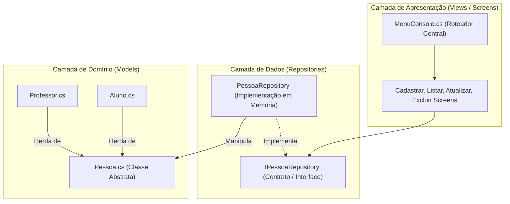

# 📚 Documentação Técnica e Arquitetura do Sistema

Bem-vindo à central de documentação e engenharia de software do **Sistema Escolar CRUD em C# (.NET)**.

Este espaço foi estruturado para demonstrar como o projeto foi concebido, modelado e implementado, utilizando padrões internacionais de engenharia como **UML (Unified Modeling Language)** e **Diagramas de Fluxo de Dados (DFD / Activity Flows)**.

---

## 🗺️ Mapa de Navegação da Documentação

A documentação está organizada em duas grandes áreas de estudo:

```text
docs/
├── uml/                            # Modelagem Padrão OMG (Estrutura e Interação)
│   ├── README.md                   # Introdução e Visão Geral da Modelagem UML
│   ├── diagrama_classes.md         # Diagrama Estrutural de Classes e Interfaces
│   ├── diagrama_casos_de_uso.md    # Diagrama de Casos de Uso e Interação do Usuário
│   └── diagrama_sequencia.md       # Diagramas de Sequência e Ciclo de Vida
│
└── fluxos/                         # Engenharia de Processos e Fluxos de Dados
    ├── README.md                   # Visão Geral do Ciclo de Vida e Menu Principal
    ├── 01_cadastrar_aluno.md       # Fluxo Detalhado: Opção 1 - Cadastro de Aluno
    ├── 02_cadastrar_professor.md   # Fluxo Detalhado: Opção 2 - Cadastro de Professor
    ├── 03_listar_pessoas.md        # Fluxo Detalhado: Opção 3 - Listagem e Polimorfismo
    ├── 04_excluir_pessoa.md        # Fluxo Detalhado: Opção 4 - Exclusão por ID
    ├── 05_atualizar_pessoa.md      # Fluxo Detalhado: Opção 5 - Atualização com Pattern Matching
    └── 00_sair_sistema.md          # Fluxo Detalhado: Opção 0 - Encerramento Seguro
```

---

## 🏛️ Visão Geral da Arquitetura em Camadas

O sistema segue os princípios de separação de responsabilidades da **Clean Architecture**, dividindo o código em três camadas essenciais:



---

## 🎯 Padrões e Práticas Demonstradas

| Conceito | Onde Está Aplicado no Código | Benefício Técnico |
| :--- | :--- | :--- |
| **Herança e Polimorfismo** | `Aluno : Pessoa` e `Professor : Pessoa` | Reutilização de atributos base (`Id`, `Nome`, `Idade`) e personalização de comportamento no método `Apresentar()`. |
| **Repository Pattern** | `IPessoaRepository` e `PessoaRepository` | Desacopla o armazenamento da interface visual. O console não sabe como os dados são guardados. |
| **Single Responsibility (SRP)** | Cada tela isolada em `Views/Screens/` | Cada classe de tela tem apenas uma razão para mudar. |
| **Dependency Inversion (DIP)** | Injeção de `IPessoaRepository` no `MenuConsole` | O menu depende de uma abstração, não de uma classe concreta. |
| **Localização e Culturas** | `CultureInfo.InvariantCulture` e `pt-BR` | Tratamento preciso de pontuação internacional para notas e padrão monetário brasileiro para salários. |
| **Programação Defensiva** | `int.TryParse` com `out`, `try/catch/finally` | O sistema nunca fecha inesperadamente por entradas inválidas do usuário. |

---

## 🔗 Acesse as Seções

- 👉 [**Explorar os Diagramas UML**](./uml/README.md)
- 👉 [**Explorar os Fluxos de Dados por Opção**](./fluxos/README.md)
