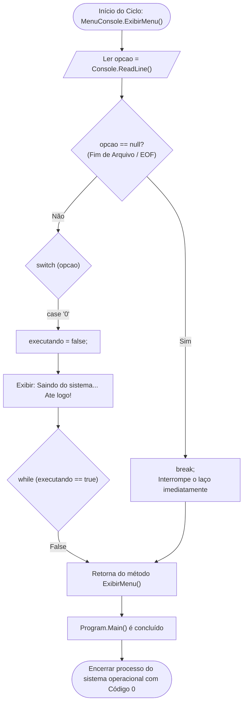

# 🔀 Fluxo de Dados: Opção 0 - Sair do Sistema

* **Operação:** Encerramento Gracioso e Seguro da Aplicação
* **Componente Responsável:** `Views/MenuConsole.cs`
* **Conceito Chave:** Controle de Ciclo de Vida e Proteção contra Fluxos Nulos (EOF)

---

## 📊 Fluxograma de Encerramento



---

## 🛡️ Destaques de Engenharia e Robustez

### 1. Encerramento Gracioso (*Graceful Shutdown*)
Em vez de forçar uma terminação abrupta da aplicação com `Environment.Exit()`, o sistema altera a flag booleana `executando = false;`. Isso permite que o programa conclua a iteração atual do laço de repetição e finalize a pilha de chamadas (*Call Stack*) de maneira limpa.

### 2. Proteção contra EOF (End of File) e Redirecionamento
Quando a aplicação é executada em pipelines de Integração Contínua (CI/CD) ou via scripts automatizados (onde a entrada padrão `Console.In` pode fechar), `Console.ReadLine()` retorna `null`. O sistema conta com uma guarda defensiva para evitar laços infinitos:

```csharp
string opcao = Console.ReadLine();

if (opcao == null)
{
    break;
}
```

---

[⬅️ Voltar para o Índice de Fluxos](./README.md) | [🏠 Voltar para a Documentação Central](../README.md)
