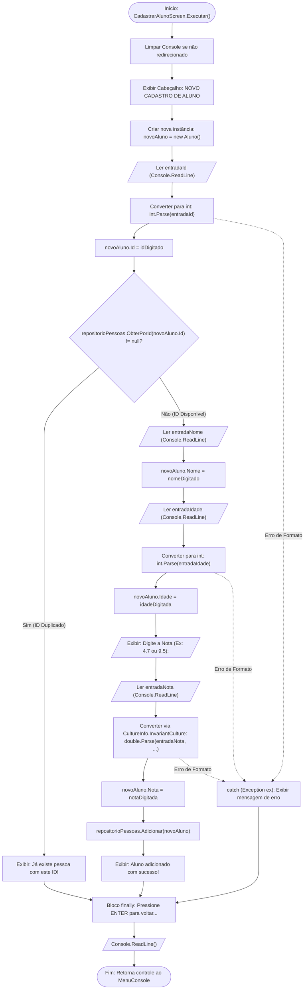

# 🔀 Fluxo de Dados: Opção 1 - Cadastrar Novo Aluno

* **Operação CRUD:** Create (Criação)
* **Componente Responsável:** `Views/Screens/CadastrarAlunoScreen.cs`
* **Entidade Manipulada:** `Models/Aluno.cs`

---

## 📊 Fluxograma de Execução e Dados

---

## 📝 Dicionário de Dados e Transformações

| Campo Coletado | Tipo Primitivo | Regra de Conversão | Exemplo de Entrada | Valor em Memória |
| :--- | :---: | :--- | :--- | :--- |
| **ID** | `int` | `int.Parse(entradaId)` | `"1"` | `1` |
| **Nome** | `string` | Atribuição direta | `"Lucas Silva"` | `"Lucas Silva"` |
| **Idade** | `int` | `int.Parse(entradaIdade)` | `"20"` | `20` |
| **Nota** | `double` | `double.Parse(entradaNota, CultureInfo.InvariantCulture)` | `"9.5"` | `9.5` |

---

## 🎯 Destaques de Engenharia
1. **Validação Fail-Fast**: O sistema valida se o ID já existe antes de pedir o restante das informações, poupando o tempo do usuário.
2. **Ponto Flutuante Invariante**: O uso de `CultureInfo.InvariantCulture` impede que `"9.5"` seja interpretado como `95` em sistemas operacionais configurados em português brasileiro.

---

[⬅️ Voltar para o Índice de Fluxos](./README.md) | [🏠 Voltar para a Documentação Central](../README.md)
