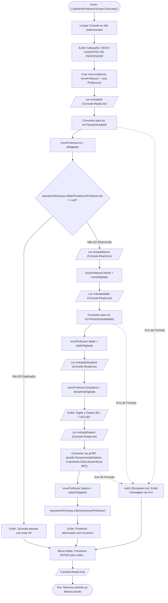

# 🔀 Fluxo de Dados: Opção 2 - Cadastrar Novo Professor

* **Operação CRUD:** Create (Criação)
* **Componente Responsável:** `Views/Screens/CadastrarProfessorScreen.cs`
* **Entidade Manipulada:** `Models/Professor.cs`

---

## 📊 Fluxograma de Execução e Dados

---

## 📝 Dicionário de Dados e Transformações

| Campo Coletado | Tipo Primitivo | Regra de Conversão | Exemplo de Entrada | Valor em Memória |
| :--- | :---: | :--- | :--- | :--- |
| **ID** | `int` | `int.Parse(entradaId)` | `"2"` | `2` |
| **Nome** | `string` | Atribuição direta | `"Carlos Alberto"` | `"Carlos Alberto"` |
| **Idade** | `int` | `int.Parse(entradaIdade)` | `"45"` | `45` |
| **Disciplina** | `string` | Atribuição direta | `"Matemática"` | `"Matemática"` |
| **Salário** | `double` | `double.Parse(entradaSalario, CultureInfo.GetCultureInfo("pt-BR"))` | `"7.822,00"` | `7822.0` |

---

## 🎯 Destaques de Engenharia
1. **Localização Monetária (`pt-BR`)**: Reconhece o ponto como separador de milhar (`7.822`) e a vírgula como separador decimal (`,00`), garantindo suporte nativo a valores da economia brasileira.
2. **Encapsulamento de Modelo**: A instância `Professor` herda os campos básicos de `Pessoa` e adiciona seus campos especializados de forma coesa.

---

[⬅️ Voltar para o Índice de Fluxos](./README.md) | [🏠 Voltar para a Documentação Central](../README.md)
