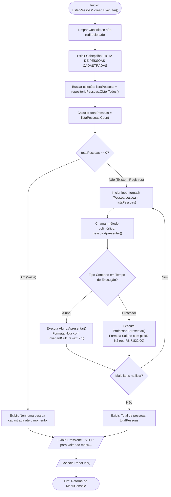

# 🔀 Fluxo de Dados: Opção 3 - Listar Todas as Pessoas

* **Operação CRUD:** Read (Leitura e Consulta)
* **Componente Responsável:** `Views/Screens/ListarPessoasScreen.cs`
* **Conceito Chave:** Polimorfismo e Ligação Tardia (*Late Binding*)

---

## 📊 Fluxograma de Execução e Apresentação Polimórfica



---

## 🎭 O Polimorfismo em Ação no Código

Observe a elegância do trecho em C#:

```csharp
foreach (Pessoa pessoa in listaPessoas)
{
    Console.WriteLine("----------------------------------");
    pessoa.Apresentar();
}
```

O método `ListarPessoasScreen` **não precisa saber** se a pessoa é um aluno ou um professor, nem precisa fazer `if/else` para descobrir. Cada objeto sabe exatamente como se apresentar:

| Entidade | Implementação de `Apresentar()` | Exemplo de Saída no Console |
| :--- | :--- | :--- |
| **`Aluno`** | `Nota.ToString("0.0", CultureInfo.InvariantCulture)` | `ALUNO: Lucas | ID: 1 | Idade: 20 | Nota: 9.5` |
| **`Professor`** | `Salario.ToString("N2", CultureInfo.GetCultureInfo("pt-BR"))` | `PROFESSOR: Carlos | ID: 2 | Idade: 45 | Disciplina: Matemática | Salario: R$ 7.822,00` |

---

## 🎯 Destaques de Engenharia
1. **Extensibilidade (Princípio Aberto/Fechado - OCP)**: Se amanhã for criada uma nova classe `Coordenador : Pessoa`, a tela de listagem continuará funcionando sem precisar alterar uma única linha de código.
2. **Desacoplamento Visual**: Toda a lógica de representação em texto do modelo reside dentro do próprio modelo.

---

[⬅️ Voltar para o Índice de Fluxos](./README.md) | [🏠 Voltar para a Documentação Central](../README.md)
