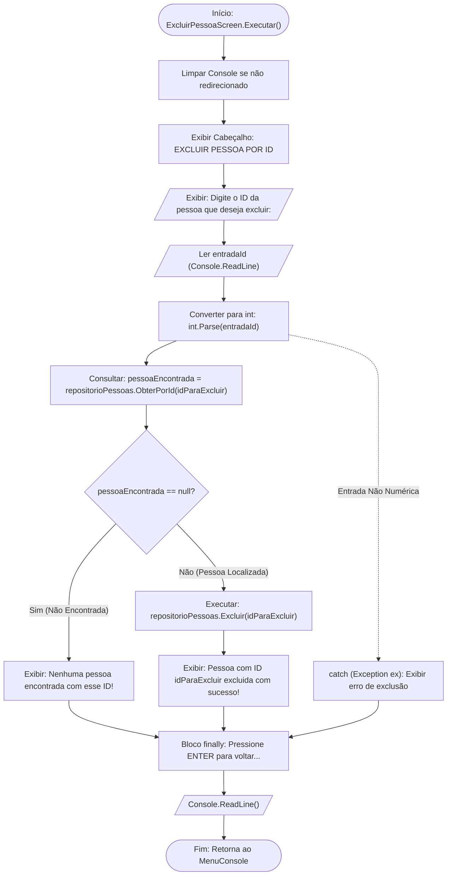

# 🔀 Fluxo de Dados: Opção 4 - Excluir Pessoa por ID

* **Operação CRUD:** Delete (Exclusão)
* **Componente Responsável:** `Views/Screens/ExcluirPessoaScreen.cs`
* **Entidade Manipulada:** `Models/Pessoa.cs` (Coleção no Repositório)

---

## 📊 Fluxograma de Execução e Exclusão

---

## 📋 Cenários de Execução e Resposta

| Cenário | Entrada do Usuário | Estado do Repositório | Resposta do Sistema | Ação no Repositório |
| :--- | :---: | :--- | :--- | :---: |
| **Exclusão com Sucesso** | `"1"` | ID 1 existe na lista | `"Pessoa com ID 1 excluida com sucesso!"` | Remove item da `List<Pessoa>` |
| **ID Inexistente** | `"99"` | ID 99 não cadastrado | `"Nenhuma pessoa encontrada com esse ID!"` | Nenhuma alteração |
| **Entrada Inválida** | `"abc"` | Qualquer | `"Erro ao excluir pessoa: A cadeia de caracteres de entrada não estava em um formato correto."` | Capturado pelo `catch` |

---

## 🎯 Destaques de Engenharia
1. **Verificação Prévia de Existência**: Evita invocar operações destrutivas sem confirmar se a entidade de fato existe no repositório.
2. **Isolamento de Memória**: O método `repositorioPessoas.Excluir(id)` encapsula a remoção da lista interna usando `_listaPessoas.Remove(pessoa)`.

---

[⬅️ Voltar para o Índice de Fluxos](./README.md) | [🏠 Voltar para a Documentação Central](../README.md)
