# 🔀 Fluxo de Dados: Opção 5 - Atualizar Pessoa por ID

* **Operação CRUD:** Update (Atualização)
* **Componente Responsável:** `Views/Screens/AtualizarPessoaScreen.cs`
* **Conceitos Chave:** Validação Defensiva com `TryParse/out`, Pattern Matching (`is`), e Localização Cultural

---

## 📊 Fluxograma de Execução e Atualização

```mermaid
flowchart TD
    START(["Início: AtualizarPessoaScreen.Executar()"]) --> CLEAR["Limpar Console se não redirecionado"]
    CLEAR --> HEADER["Exibir Cabeçalho: ATUALIZAR PESSOA POR ID"]

    HEADER --> LOOP_VAL_START["Iniciar loop: while (idValido == false)"]
    LOOP_VAL_START --> PROMPT_ID[/"Solicitar ID da pessoa a atualizar"/]
    PROMPT_ID --> READ_ID[/"Ler entradaId (Console.ReadLine)"/]
    READ_ID --> TRY_PARSE["bool conseguiuConverter = int.TryParse(entradaId, out idParaAtualizar)"]
    TRY_PARSE --> CHECK_POS["bool numeroPositivo = idParaAtualizar > 0"]

    CHECK_POS --> CHECK_VALID{"conseguiuConverter == true && numeroPositivo == true?"}

    CHECK_VALID -->|"Não (Inválido)"| WARN_INVALID["Exibir: ID inválido! Deve ser inteiro e maior que zero."]
    WARN_INVALID --> LOOP_VAL_START

    CHECK_VALID -->|"Sim (Válido)"| SET_VALID["idValido = true\nSai do loop de validação"]

    SET_VALID --> QUERY_REPO["Consultar: pessoaEncontrada = repositorioPessoas.ObterPorId(idParaAtualizar)"]

    QUERY_REPO --> CHECK_NULL{"pessoaEncontrada == null?"}

    CHECK_NULL -->|"Sim (Não Existe)"| NOT_FOUND["Exibir: Nenhuma pessoa encontrada com esse ID!"]
    NOT_FOUND --> FINALLY_BLOCK

    CHECK_NULL -->|"Não (Localizada)"| SHOW_CURRENT["Exibir dados atuais chamando:\npessoaEncontrada.Apresentar()"]

    SHOW_CURRENT --> READ_NEW_NOME[/"Digitar novo nome: pessoaEncontrada.Nome = novoNome"/]
    READ_NEW_NOME --> READ_NEW_IDADE[/"Digitar nova idade: int.Parse(entradaNovaIdade)"/]

    READ_NEW_IDADE --> PATTERN_MATCH{"pessoaEncontrada is Aluno ou Professor?"}

    PATTERN_MATCH -->|"is Aluno aluno"| FLOW_ALUNO["1. Digitar nova nota (Ex: 4.7 ou 9.5)\n2. double.Parse(entrada, InvariantCulture)\n3. aluno.Nota = novaNota"]
    PATTERN_MATCH -->|"is Professor professor"| FLOW_PROF["1. Digitar nova disciplina\n2. Digitar novo salário (Ex: 7.822,00)\n3. double.Parse(entrada, pt-BR)\n4. professor.Salario = novoSalario"]

    FLOW_ALUNO --> COMMIT_REPO["Persistir: repositorioPessoas.Atualizar(pessoaEncontrada)"]
    FLOW_PROF --> COMMIT_REPO

    COMMIT_REPO --> SUCCESS_MSG["Exibir: Dados do ID atualizados com sucesso!"]
    SUCCESS_MSG --> FINALLY_BLOCK

    FINALLY_BLOCK["Bloco finally: Pressione ENTER para voltar..."] --> READ_KEY[/"Console.ReadLine()"/]
    READ_KEY --> END(["Fim: Retorna ao MenuConsole"])
```



---

## 🛡️ Destaques da Programação Defensiva com `TryParse` e `out`

O trecho de código abaixo protege a aplicação contra qualquer entrada errônea de ID sem gerar exceções (*Zero Exception Overhead*):

```csharp
int idParaAtualizar = default;
bool idValido = false;

while (idValido == false)
{
    string entradaId = Console.ReadLine();
    bool conseguiuConverter = int.TryParse(entradaId, out idParaAtualizar);
    bool numeroPositivo = idParaAtualizar > 0;

    if (conseguiuConverter == true && numeroPositivo == true)
    {
        idValido = true;
    }
    else
    {
        Console.WriteLine("\nID invalido! O ID deve ser um numero inteiro e maior que zero.");
        Console.Write("Por favor, digite o ID novamente: ");
    }
}
```

---

## 🧩 Pattern Matching Moderno em C#

Em vez de verificações manuais de strings ou typecasts inseguros (`(Aluno)pessoa`), o sistema usa **Pattern Matching Type Pattern**:

```csharp
if (pessoaEncontrada is Aluno aluno)
{
    Console.Write("Digite a nova nota (Ex: 4.7 ou 9.5): ");
    string entradaNovaNota = Console.ReadLine();
    double novaNota = double.Parse(entradaNovaNota, CultureInfo.InvariantCulture);
    aluno.Nota = novaNota;
}
else if (pessoaEncontrada is Professor professor)
{
    Console.Write("Digite a nova disciplina: ");
    string novaDisciplina = Console.ReadLine();
    professor.Disciplina = novaDisciplina;

    Console.Write("Digite o novo salario (Ex: 7.822,00): ");
    string entradaNovoSalario = Console.ReadLine();
    double novoSalario = double.Parse(entradaNovoSalario, CultureInfo.GetCultureInfo("pt-BR"));
    professor.Salario = novoSalario;
}
```

---

[⬅️ Voltar para o Índice de Fluxos](./README.md) | [🏠 Voltar para a Documentação Central](../README.md)
