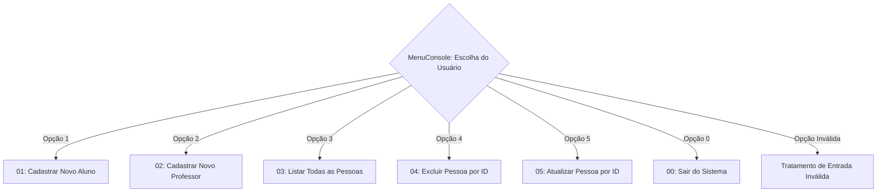

# 🔀 Engenharia de Fluxos de Dados e Processos

Esta pasta contém o detalhamento passo a passo do ciclo de vida e dos **Fluxos de Dados** de cada opção selecionável pelo usuário no console.

Cada documento traz um fluxograma visual em **Mermaid**, a tabela de entradas e saídas, as regras de validação aplicadas e o comportamento de persistência no repositório.

---

## 🧭 Menu de Opções do Sistema



---

## 📂 Navegação Rápida pelos Fluxos

| Opção | Nome do Processo | Tipo de Operação CRUD | Arquivo com Fluxograma Completo |
| :---: | :--- | :---: | :--- |
| **`1`** | **Cadastrar Novo Aluno** | **Create (C)** | [Acessar Fluxo 01](./01_cadastrar_aluno.md) |
| **`2`** | **Cadastrar Novo Professor** | **Create (C)** | [Acessar Fluxo 02](./02_cadastrar_professor.md) |
| **`3`** | **Listar Pessoas Cadastradas** | **Read (R)** | [Acessar Fluxo 03](./03_listar_pessoas.md) |
| **`4`** | **Excluir Pessoa por ID** | **Delete (D)** | [Acessar Fluxo 04](./04_excluir_pessoa.md) |
| **`5`** | **Atualizar Pessoa por ID** | **Update (U)** | [Acessar Fluxo 05](./05_atualizar_pessoa.md) |
| **`0`** | **Sair do Sistema** | **Encerramento** | [Acessar Fluxo 00](./00_sair_sistema.md) |

---

## 🛡️ Padrão Comum de Execução em Todas as Telas

Todas as telas seguem rigorosamente a mesma estrutura de qualidade:

1. **Limpeza Visual Segura**:
   ```csharp
   if (Console.IsOutputRedirected == false)
   {
       Console.Clear();
   }
   ```
2. **Tratamento de Exceções**: Todo o bloco de execução é envolvido em `try / catch (Exception ex)` para capturar falhas de conversão ou erros inesperados sem travar a aplicação.
3. **Pausa para Leitura do Usuário**: O bloco `finally` garante que uma mensagem `Pressione ENTER para voltar ao menu...` seja exibida antes de retornar o controle ao `MenuConsole`.

---

[🏠 Voltar para a Documentação Central](../README.md)
