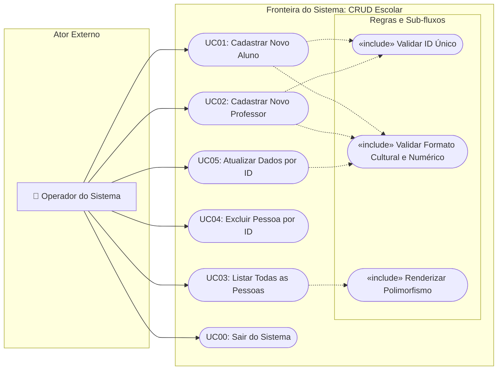

# 🎭 Diagrama de Casos de Uso (Use Case Diagram)

* **Categoria UML:** Diagrama Comportamental
* **Propósito:** Mapear os limites do sistema, os atores externos que interagem com a aplicação e o conjunto de casos de uso (funcionalidades e objetivos) disponibilizados pelo sistema.

---

## 📊 Visualização do Diagrama

---

## 📋 Matriz de Especificação dos Casos de Uso

| ID | Nome do Caso de Uso | Ator Principal | Pré-condição | Pós-condição | Tela Encarregada |
| :---: | :--- | :--- | :--- | :--- | :--- |
| **UC01** | Cadastrar Novo Aluno | Operador | Sistema em execução no Menu Principal. | Instância de `Aluno` adicionada à lista do repositório. | `CadastrarAlunoScreen` |
| **UC02** | Cadastrar Novo Professor | Operador | Sistema em execução no Menu Principal. | Instância de `Professor` adicionada à lista do repositório. | `CadastrarProfessorScreen` |
| **UC03** | Listar Pessoas | Operador | Ter ou não pessoas cadastradas. | Dados de todos os alunos e professores exibidos com polimorfismo. | `ListarPessoasScreen` |
| **UC04** | Excluir Pessoa por ID | Operador | Informar um ID numérico existente. | Instância correspondente removida da coleção em memória. | `ExcluirPessoaScreen` |
| **UC05** | Atualizar Pessoa por ID | Operador | O ID informado deve pertencer a uma pessoa existente. | Atributos da pessoa atualizados conforme o seu tipo específico. | `AtualizarPessoaScreen` |
| **UC00** | Sair do Sistema | Operador | Selecionar a opção 0 no menu. | Aplicação encerra a execução de forma limpa. | `MenuConsole` |

---

## 🛡️ Regras de Negócio e Inclusões («include»)

1. **`Validar ID Único`**: Antes de cadastrar um Aluno ou Professor, o sistema consulta `ObterPorId(id)`. Se já existir registro, a operação é interrompida com aviso explicativo (*Fail-Fast*).
2. **`Validar Formato Cultural e Numérico`**:
   - Para notas: aceita ponto flutuante com ponto (`CultureInfo.InvariantCulture`).
   - Para salários: aceita separador de milhar com ponto e decimal com vírgula (`pt-BR`).
   - Para IDs: loop defensivo de validação com `int.TryParse` impedindo números negativos ou zero.
3. **`Renderizar Polimorfismo`**: Durante a listagem, o método abstrato `Apresentar()` invoca dinamicamente o comportamento de cada subclasse, formatando notas e salários no padrão exigido.

---

[⬅️ Voltar para o Índice de UML](./README.md) | [🏠 Voltar para a Documentação Central](../README.md)
