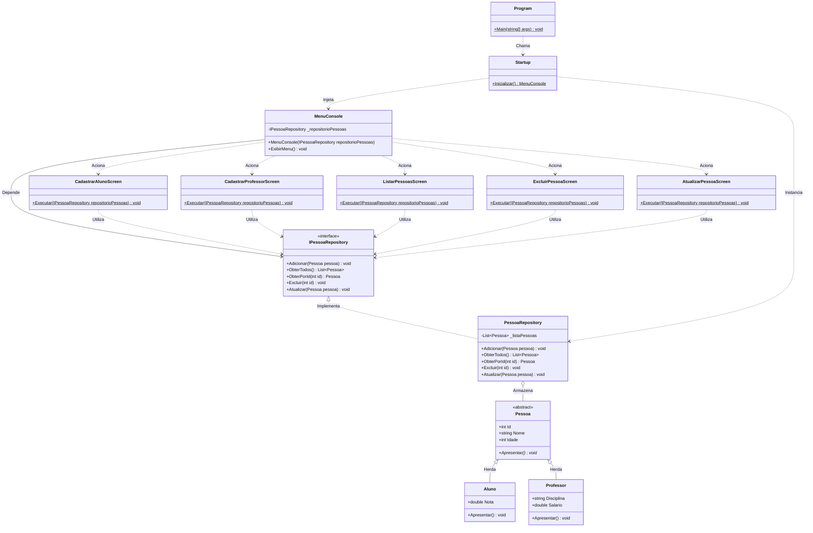

# 🏛️ Diagrama de Classes (Class Diagram)

* **Categoria UML:** Diagrama Estrutural
* **Propósito:** Representar a estrutura estática do sistema, incluindo classes, interfaces, atributos, métodos, visibilidades e os relacionamentos de herança, implementação e dependência.

---

## 📊 Visualização do Diagrama

---

## 🔍 Dicionário de Elementos e Responsabilidades

### 1. Camada de Domínio (`Models`)
* **`Pessoa` (Classe Abstrata)**: Entidade base que estabelece o contrato comum para qualquer indivíduo no sistema (`Id`, `Nome`, `Idade`). Define o método abstrato `Apresentar()`, forçando as classes filhas a implementarem sua própria forma de apresentação.
* **`Aluno` (Entidade Concreta)**: Especialização de `Pessoa`. Adiciona o atributo `Nota` e implementa `Apresentar()`, formatando a nota com separador de ponto (`CultureInfo.InvariantCulture`).
* **`Professor` (Entidade Concreta)**: Especialização de `Pessoa`. Adiciona `Disciplina` e `Salario`, implementando `Apresentar()` com formatação monetária brasileira (`CultureInfo.GetCultureInfo("pt-BR")`).

### 2. Camada de Acesso a Dados (`Repositories`)
* **`IPessoaRepository` (Interface Contrato)**: Define os métodos obrigatórios para um repositório de pessoas (`Adicionar`, `ObterTodos`, `ObterPorId`, `Excluir`, `Atualizar`). Garante o Princípio de Inversão de Dependência (DIP).
* **`PessoaRepository` (Implementação)**: Implementa o contrato armazenando as instâncias em uma coleção `List<Pessoa>` em memória, encapsulando as operações de busca e alteração via LINQ.

### 3. Camada de Apresentação (`Views` & `Screens`)
* **`MenuConsole`**: Componente orquestrador do loop de interação com o usuário. Recebe a interface `IPessoaRepository` via injeção por construtor e delega o fluxo para a tela correspondente.
* **`Screens` (`CadastrarAlunoScreen`, `CadastrarProfessorScreen`, etc.)**: Classes estáticas especialistas com foco exclusivo em renderizar as instruções no console, coletar a entrada do usuário e acionar o repositório.

---

## 📐 Notação e Simbologia UML Utilizada

| Símbolo | Significado | Exemplo no Projeto |
| :---: | :--- | :--- |
| `+` | Visibilidade Pública | `+Adicionar(Pessoa pessoa)` |
| `-` | Visibilidade Privada | `-List<Pessoa> _listaPessoas` |
| `$` | Membro Estático | `+Inicializar()$ MenuConsole` |
| `*` | Método Abstrato | `+Apresentar()* void` |
| `<|--` | Generalização / Herança | `Pessoa <|-- Aluno` |
| `<|..` | Realização / Interface | `IPessoaRepository <|.. PessoaRepository` |
| `o--` | Agregação | `PessoaRepository o-- Pessoa` |
| `-->` | Associação Dirigida | `MenuConsole --> IPessoaRepository` |
| `..>` | Dependência | `CadastrarAlunoScreen ..> IPessoaRepository` |

---

[⬅️ Voltar para o Índice de UML](./README.md) | [🏠 Voltar para a Documentação Central](../README.md)
