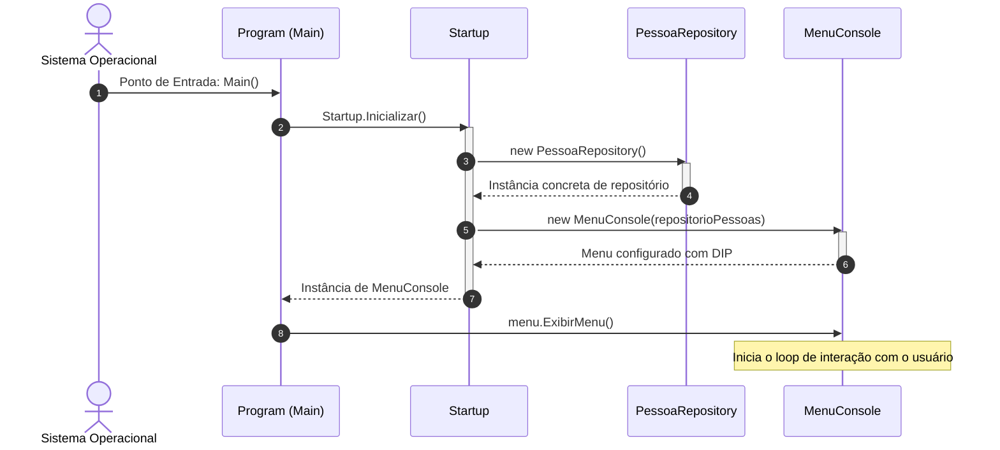
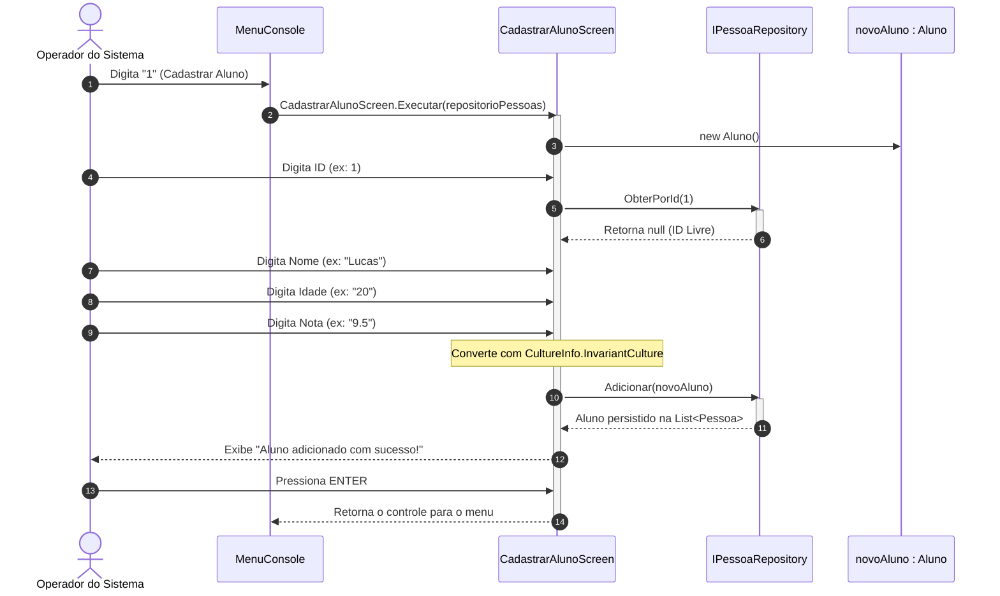
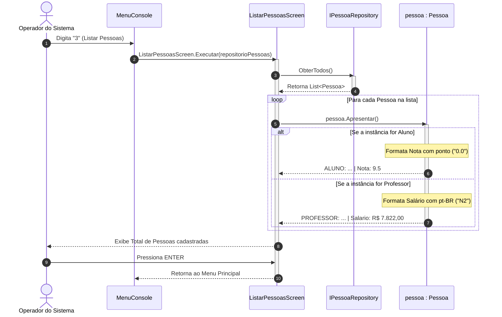

# ⏱️ Diagramas de Sequência (Sequence Diagrams)

* **Categoria UML:** Diagrama de Interação
* **Propósito:** Demonstrar a troca de mensagens ordenada no tempo entre os diferentes componentes de software durante a execução das tarefas principais.

---

## 1. Diagrama de Sequência: Inicialização e Injeção de Dependências

Mapeia a criação das instâncias e a ligação desacoplada dos componentes antes da exibição do menu ao usuário.

---

## 2. Diagrama de Sequência: Cadastro de Aluno (Validação Fail-Fast)

Demonstra a leitura dos dados do console, a verificação de duplicidade de ID no repositório e a persistência final.

---

## 3. Diagrama de Sequência: Listagem e Apresentação Polimórfica

Demonstra como o repositório entrega a lista genérica de `Pessoa` e o loop executa dinamicamente o método sobrescrito de cada tipo derivado.

---

[⬅️ Voltar para o Índice de UML](./README.md) | [🏠 Voltar para a Documentação Central](../README.md)
